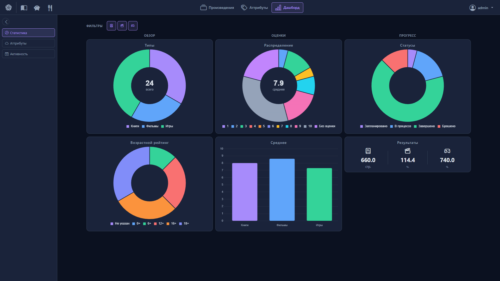

[](https://github.com/Renhas/Midgard-Nexus/releases)
[](LICENSE)
[](https://github.com/Renhas/Midgard-Nexus/actions/workflows/tests.yml)

# Midgard Nexus

Локальное веб-приложение для одного человека или семьи. Хранит медиатеку произведений, а в будущем также финансы и рецепты. Все данные остаются на вашей машине.

> ⚠️ **Ранний этап разработки.** Приложение еще не готово к повседневному использованию. Возможны баги, отсутствует бэкап. API и модели данных могут меняться между версиями. Считайте текущую версию ознакомительной.

## О проекте

Приложение создается с двумя целями.

Первая - учебная. Освоить Django, работу с PostgreSQL, Docker, современный фронтенд-стек и практики CI/CD на реальном проекте.

Вторая - практическая. Собрать в одном месте то, что обычно разбросано по десяткам сервисов и приложений:

- **Медиатека** - единая виртуальная полка для книг, фильмов и игр. Без привязки к внешним базам, только ваши личные произведения.
- **Финансы** - отслеживание доходов и расходов, в том числе распределенных по разным банкам и счетам.
- **Рецепты** - личная книга рецептов с удобным управлением с телефона и возможностью вести разные версии одного блюда без дублирования данных.

Приложение хранит данные локально. Интернет нужен только при первой сборке, чтобы скачать внешние библиотеки. Никакие данные не отправляются за пределы вашей машины.

Мобильная версия пока не разрабатывается.

## Скриншоты

<!--
<div align="center">
  
  <p><em>Дашборд со статистикой</em></p>
</div>
-->

## Модули

### ✅ Архивы Вёр (Vor Archives)
Полноценная медиатека для каталогизации вашей коллекции.

**Возможности:**
- **Каталог:** книги, фильмы и игры. Учет авторов, жанров, платформ и пользовательских тегов.
- **Организация:** многоуровневые коллекции, связи между произведениями, Drag'n'Drop для произведений и коллекций.
- **Личные метрики:** статусы, оценки и текущий прогресс.
- **Аналитика:** дашборд со статистикой и историей активности.
- **Поиск и вид:** два режима отображения (список и плитка), базовый поиск, сортировка и частичная фильтрация.

**В планах:** полировка интерфейса, создание бэкапов, заметки к произведениям и расширение фильтрации (добавление исключающих фильтров и покрытие всех полей), а также прочие мелкие QoL-фичи.

### 🚧 Пользователи (Users)
Базовые логин, регистрация и аутентификация. Профиль пользователя и настройки пока отсутствуют.

### ⏳ Пещера Фафнира (Fafnir's Cave)
Финансовый модуль. Сейчас заглушка с пометкой WIP.

### ⏳ Записи Квасира (Kvasir's Records)
Кулинарный модуль. Сейчас заглушка с пометкой WIP.

## Быстрый старт

### Требования

- Docker и Docker Compose

### Способ 1: Автоматический запуск (рекомендуется)

1. Скачайте последний архив (`midgard-nexus-0.1.0.zip` или `.tar.gz`) из раздела [Releases](https://github.com/Renhas/Midgard-Nexus/releases).
2. Распакуйте архив в удобную папку.
3. Запустите приложение:
   - **Windows:** дважды кликните по файлу `START.bat` в корне проекта.
   - **Linux / macOS:** выполните в терминале `./scripts/run.sh`.

Скрипт автоматически создаст файл `.env` с безопасным секретным ключом и стандартными данными для администратора. В процессе он спросит, нужно ли заполнить базу демонстрационными данными (по умолчанию - да, для пользователя `admin`).

Приложение будет доступно на `http://localhost`.

### Способ 2: Ручной запуск

Используйте этот способ, если вы хотите контролировать каждый шаг.

1. **Инициализация окружения.** Сгенерируйте файл `.env` с секретным ключом:
   - **Windows:** `./scripts/init-env.ps1`
   - **Linux / macOS:** `./scripts/init-env.sh`
2. **Настройка.** При необходимости откройте созданный `.env` и измените параметры (например, данные суперпользователя).
3. **Запуск контейнеров:**
   ```bash
   docker compose up -d
   ```
4. **Демонстрационные данные (опционально).** Загрузите тестовые данные, перенаправив команду в контейнер:
   - **Windows:** `./scripts/manage.ps1 seed_demo`
   - **Linux / macOS:** `./scripts/manage.sh seed_demo`

### Доступ по локальной сети

Если вы хотите открыть приложение с другого устройства в вашей сети (например, с телефона):

1. Узнайте локальный IP-адрес вашего компьютера (например, `192.168.1.10`).
2. Добавьте его в файл `.env` в переменные `DJANGO_ALLOWED_HOSTS`.
3. Пересоберите и перезапустите приложение:
   - **Windows:** `./scripts/run.ps1 -Rebuild`
   - **Linux / macOS:** `./scripts/run.sh --rebuild`
   - **Или вручную:** `docker compose up -d --build`

### Если порт 80 занят

По умолчанию приложение доступно на стандартном порту 80. Если он уже занят другой программой (например, IIS или другим сервером), вы можете изменить порт:

1. Измените порт в файле `.env` через переменную `NGINX_PORT` (например, `NGINX_PORT=8080`).
2. Пересоберите и перезапустите приложение:
   - **Windows:** `./scripts/run.ps1 -Rebuild`
   - **Linux / macOS:** `./scripts/run.sh --rebuild`
   - **Или вручную:** `docker compose up -d --build`
3. Теперь приложение будет доступно по адресу `http://localhost:<ваш_порт>`.

### Сброс данных

Если вы хотите полностью удалить все контейнеры и данные базы данных (файл `.env` при этом сохраняется):

- **Windows:** `./scripts/reset.ps1`
- **Linux / macOS:** `./scripts/reset.sh`

## Стек

**Бэкенд**

- Django 6.1.2
- PostgreSQL 16 (alpine)
- gunicorn 26.0.0

**Фронтенд**

- Bootstrap 5.3.3
- Bootstrap Icons 1.13.1
- Lucide Icons (latest)
- HTMX 1.9.10
- Alpine.js 3.14.1
- Chart.js 4.4.4
- Chart.js WordCloud 4.4.5
- SortableJS 1.15.2

**Инфраструктура**

- Docker, Docker Compose
- nginx

Все библиотеки фронтенда хранятся локально, CDN не используется.

## Структура проекта

- `src/apps/` — модули приложения (vor_archives, users, fafnir_cave, kvasir_records).
- `src/config/` — настройки Django и роутинг.
- `docker/` — Dockerfile, конфигурация nginx и скрипты инициализации контейнеров.
- `scripts/` — вспомогательные скрипты для управления (запуск, управление Django-командами).
- `docker-compose.yml` и `docker-compose.prod.yml` — конфигурации для разработки и продакшена.

## Roadmap

Разработка ведется итеративно. Пользовательские фичи добавляются в промежуточных обновлениях, а крупные релизы служат точками стабилизации.

- **v0.1.0 (текущий)** - Первый публичный релиз. Базовый функционал медиатеки: каталог произведений, коллекции, сортировка, частичная фильтрация и дашборд со статистикой.
- **Промежуточные обновления** - Постепенное добавление новых экранов (About, Профиль пользователя), расширение возможностей фильтрации, написание тестов, рефакторинг кода и исправление мелких багов.
- **v1.0.0** - Стабильный релиз медиатеки. К этому моменту модуль будет обладать полным набором запланированных функций, включая заметки к произведениям, бэкап и восстановление данных, а также кастомные страницы ошибок.
- **v2.0.0** - Финансовый модуль (Пещера Фафнира).
- **v3.0.0** - Кулинарный модуль (Записи Квасира).

*В планах также: сборка на SQLite (альтернатива Docker) и пост-релизные улучшения первого модуля.*

## Credits

- Favicon: <a href="https://www.flaticon.com/free-icons/vortex" title="vortex icons">Vortex icons created by Magnific - Flaticon</a>
- [Bootstrap 5](https://getbootstrap.com/) (MIT)
- [Bootstrap Icons](https://icons.getbootstrap.com/) (MIT)
- [Lucide Icons](https://lucide.dev/) (ISC)
- [HTMX](https://htmx.org/) (BSD 2-Clause)
- [Alpine.js](https://alpinejs.dev/) (MIT)
- [Chart.js](https://www.chartjs.org/) (MIT)
- [chartjs-chart-wordcloud](https://github.com/sgratzl/chartjs-chart-wordcloud) (MIT)
- [SortableJS](https://sortablejs.github.io/Sortable/) (MIT)

## Лицензия

Проект распространяется под лицензией MIT. Подробности в файле [LICENSE](LICENSE).

## Отказ от ответственности

Приложение предоставляется «как есть» (as is), без каких-либо гарантий. Автор не несет ответственности за любые последствия использования, включая возможную потерю данных. Используйте на свой риск. Перед вводом важных данных убедитесь, что понимаете, как работает приложение, и помните: автоматический бэкап пока не реализован.
